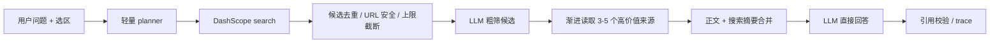

# Hermes 轻量联网答疑重构方案

日期：2026-06-25

执行状态：实施中。阶段 0-3 已落地并通过针对性测试；阶段 4 已完成 dashboard/tool 默认入口切换，旧 research pipeline 仍作为 legacy 兼容接口存在，待真实 canary 后删除或进一步收缩。本文档不是继续给单个失败 query 打补丁的清单。

关联背景文档：

- `docs/superpowers/plans/2026-06-20-hermes-web-research-pipeline-upgrade-plan.md`
- `docs/superpowers/plans/2026-06-21-hermes-contract-lite-web-research-design.md`
- `docs/superpowers/plans/2026-06-23-hermes-web-research-contract-and-eval-protocol.md`
- `docs/superpowers/plans/2026-06-23-hermes-research-diff-audit.md`

## 0. 暂停点和事实状态

本轮调试已经证明：当前联网失败不是单个 provider bug，也不是继续加一个 fallback 就能稳定解决的问题。

### 0.1 当前已验证事实

1. DashScope search 可以返回候选网页。
2. DashScope `web_extractor` 可以调用，但必须使用百炼 Responses API 的 `web_search + web_extractor` 工具组合。
3. `qwen3.7-max` 在当前账号下返回过 `403 PERMISSION_DENIED`，原因是 free tier exhausted / free-tier-only。
4. `qwen3.7-plus` 真实 smoke 成功，可以作为 DashScope `web_extractor` 执行模型。
5. 将 `web.extract_backend` 改为 `dashscope` 后，trace 中 `extract_backend` 确实变为 `dashscope`。
6. DDGS fallback 扩散在配置切换后基本停止。
7. 但完整 research canary 仍然慢，主要耗时转移到 `extract_ms` 和 `critic_ms`。

典型 canary 现象：

```text
search_backend: dashscope
extract_backend: dashscope
extracted_pages: 0
summary_only_pages: 1
fallback_attempts: []
extract_ms: 26s-54s
critic_ms: 41s-54s
total: 130s+
```

这说明 provider wiring 有进展，但产品链路仍不达标。

### 0.2 当前 dirty diff 的性质

当前两个仓库都有未提交改动：

`/Users/pipi/Downloads/hermes-agent-main` 中的改动大多属于基础 provider 能力：

- DashScope provider 支持 `extract()`。
- `dashscope` 从 search-only 变为 extract-capable。
- 默认 extract model 改为 `qwen3.7-plus`。
- Responses endpoint 和 workspace header 处理。
- 对应 provider tests。

这些方向大体应保留，但需要独立提交和验证。

`/Users/pipi/hermes-custom` 中的部分改动已经呈现补丁化倾向：

- 给 evidence critic 增加更多失败兜底。
- 给“关系题/定义题”增加标题例外。
- 调整 extract URL 上限以适配某个 canary。

这些不应继续扩张。它们正是“拆东墙补西墙”的症状。

## 1. 核心结论

Hermes 联网能力当前误入了“审计级研究系统”的路径。

用户真实需求更接近：

```text
答疑机器人 + 信息获取工作台
```

也就是：

- 用户问一个问题。
- 系统联网找更多材料。
- 读一点关键网页。
- 用更详细、更可信的方式回答。
- 给出可见来源。
- 允许保存为笔记或卡片。

它不是：

- 金融数据终端。
- 法律/医疗证据审查系统。
- 学术系统综述引擎。
- 每个普通概念题都要多轮 evidence critic 的研究代理。

因此联网链路必须从“严格研究”改为“轻量联网答疑”。不再保留两个搜索模式，也不再为普通产品形态维护一条独立的严格研究路径。旧 research pipeline 只作为迁移期遗留实现保留，目标是逐步退场。

## 2. 设计原则

### 2.1 LLM 负责语义判断

LLM 应负责：

- 用户到底在问什么。
- 选区是查询主体，还是只是上下文。
- 哪些搜索结果和问题有关。
- 某个网页摘要/正文是否足以帮助回答。
- 在代码给定的候选池和读取预算内，选择哪些页面值得读、哪些页面值得引用。
- 回答应怎样组织。
- 来源限制和不确定性如何表达。

### 2.2 代码负责确定性合同

代码应负责：

- 模式合同：当前文章、本地、联网、混合模式是否应该调用哪些检索。
- URL 安全检查。
- 搜索结果去重。
- 请求超时。
- 最大 query 数、候选数、读取 URL 数。
- 搜索候选池硬上限。
- 全量搜索结果截断、去重、排序输入准备。
- 来源编号。
- 引用编号是否合法。
- trace 字段完整性。
- provider 是否可用。
- 成本和总时长保护。

### 2.3 代码不应做语义裁判

默认路径中，代码不应直接决定：

- 某个标题是不是“相邻概念”。
- 某个 domain 对当前问题是否足够权威。
- 知乎/CSDN/百科/官方文档在当前问题中是否一定不能用。
- 关系题、定义题、人物题、公司题应该走哪套专门规则。
- 是否必须 2 个独立来源才能回答普通概念题。

这些判断可以作为 LLM 输入中的 hint，但不应成为代码硬拒绝。

### 2.4 候选数量分工

候选条数采用“代码定上限，LLM 定取舍”的分工：

- 代码不把搜索引擎能返回的所有页面全部交给 LLM。
- 代码负责设置 query 数、每个 query 返回数、去重后候选池上限、读取页数上限。
- LLM 只在候选池内根据标题、摘要、域名、时间和问题相关性选择要读取的页面。
- 代码按 LLM 选择执行抽取，并继续校验 URL 安全、引用 ID 和 trace。
- 如果搜索结果本身很少，就用实际数量；如果搜索结果很多，也先截断到候选池上限再判断。

推荐第一版边界：

```text
query 数：2-4
每个 query 返回：5-8 条
去重后候选池：最多 20 条
抽取正文：摘要不足时默认 3 页，详细/复杂问题最多 6 页
最终引用来源：通常 3-6 个
```

## 3. 当前设计问题

### 3.1 默认链路太重

当前链路近似为：


这套链路把普通答疑做成了审计式研究，不适合作为 Hermes 的联网搜索基础形态。

对“人工智能和深度学习的关系是什么？”这种问题，合理体验应该是 20-45 秒内给出解释，而不是：

- 抽取多页。
- 证据裁判几十秒。
- 拒绝多个来源。
- 最后说预算不足。

### 3.2 语义门分散太多

同一个来源是否可用，可能被多处判断：

- planner source preferences
- ranker quality tags
- retrieval health
- `_ranked_sources_for_evidence`
- evidence critic
- post-critic repair
- source quality contract
- synthesis guard

这导致一个问题：某处刚修通，另一处又把结果拦掉。

### 3.3 summary-only 被过度压制

普通概念解释题中，搜索摘要通常足够回答基础关系。

比如：

```text
人工智能是更宽泛的领域，深度学习是机器学习的一种，也是实现 AI 的重要方法。
```

这类稳定常识不需要强制全文正文，也不需要多来源独立核验。

正确行为应该是：

- 能读正文就用正文。
- 正文失败就用搜索摘要。
- 清楚标记“摘要来源”。
- 不把 `extracted_pages=0` 等同于“没有联网证据”。

### 3.4 budget 太碎

当前预算拆成 planner、search、extract、critic、fallback、synthesis 多段。

问题是用户不关心哪一段超时。用户只看到：

- 等了很久。
- 回答失败。
- trace 里出现很多技术 warning。

预算应从用户体验倒推：

```text
普通联网答疑：总时长 30-45 秒
```

内部阶段预算只用于保护系统，不应成为产品体验的主要叙事。

### 3.5 fallback search 容易扩散

旧链路中，一旦 retrieval health 判定弱，就可能触发 DDGS 或其它 fallback。

但对普通答疑，这通常没有必要：

- 搜索已有 5 个候选。
- 只是来源质量不完美。
- 用户需要的是解释，不是审计报告。

默认路径不应该自动扩散搜索。fallback 只在主搜索接口失败时启用一次，不因“来源不够完美”或“问题更严肃”自动扩散。

## 4. 新目标架构

联网能力收敛为一个明确路径：

```text
Lightweight Web QA   唯一路径，面向答疑和信息获取
```

用户界面只需要暴露“联网”或“知识库 + 联网”。内部也不再把问题路由到两套搜索模式。高风险或强时效问题不是切换到另一条复杂链路，而是在同一条 Lightweight Web QA 中提高来源提示、表达不确定性，必要时提示用户需要人工核验。

### 4.1 Lightweight Web QA

目标：

- 快。
- 稳。
- 有来源。
- 允许有限证据。
- 不因抽取失败而清零。

推荐流程：



关键点：

- 搜索候选不应太少，也不应全量返回：简单问题通常保留 8-10 条，探索型/多面向问题最多保留 20 条。
- 候选池由代码截断和去重，候选取舍由 LLM 根据标题、摘要、域名和问题相关性决定。
- 抽取不是固定 1-2 条，而是渐进式读取：
  - 简单事实/定义题：读取 2-3 条。
  - 普通解释/对比/关系题：摘要足够时不读取正文，摘要不足时读取 3 条。
  - 探索型问题、争议题、公司/产品方法论解读：最多读取 6 条。
- 先用搜索摘要做粗筛，再把最有信息量、来源类型互补的页面送去全文/正文抽取。
- 达到信息充足即可停止，不为凑数量继续读取。
- 读取失败时保留搜索摘要。
- 不跑 evidence critic。
- 不跑 repair critic。
- 不跑 fallback search，除非主搜索失败。
- 回答模型可以继续使用当前主模型或 DeepSeek；`qwen3.7-plus` 只作为 DashScope web extractor 执行模型。
- 高风险或强时效问题可以在同一路径中增加“来源有限/需要核验”的回答约束，但不启动另一套研究流程。

## 5. Provider 设计

### 5.1 DashScope Search

保留：

- `search_backend: dashscope`
- `search_strategy=max`
- 返回搜索候选和摘要。

搜索摘要在 Lightweight Web QA 中是可用材料，不是低等级废料。

### 5.2 DashScope Web Extractor

保留：

- `extract_backend: dashscope`
- `DASHSCOPE_WEB_EXTRACT_MODEL=qwen3.7-plus`
- Responses API `/compatible-mode/v1/responses`
- `tools=[web_search, web_extractor]`

定位：

```text
qwen3.7-plus 是网页读取执行器，不是最终回答模型。
```

注意：

- `qwen3.7-max` 当前账号免费额度已耗尽，不适合作默认。
- `qwen3.7-plus` 可用，但也会消耗百炼额度。
- 默认路径要限制读取页数，不能把 extractor 当无限 crawler。

### 5.3 Local Extract

`local_extract` 仍应保留为低成本补充：

- 对简单 HTML 页面先尝试本地抽取。
- 本地抽取失败再用 DashScope extractor。
- 或者反过来：DashScope search 摘要足够时，不必读取全文。

最终选择应以成本和稳定性为准，不应为了“必须全文”牺牲体验。

## 6. 预算和上限策略

预算仍然需要，但要简化。

### 6.1 预算边界

建议：

```text
总预算：30-45 秒
搜索：8-12 秒
候选：每个 query 5-8 条，去重后候选池最多 20 条
抽取：摘要不足时默认 3 个 URL，复杂问题最多 6 个 URL
抽取单页：10-15 秒
synthesis：10-15 秒
fallback search：默认关闭
critic：默认关闭
```

超时策略：

- 搜索成功但抽取失败：用搜索摘要回答。
- 抽取部分成功：用成功正文 + 其它摘要回答。
- 搜索失败：如 local_web 可基于本地回答，并说明联网失败；web_only 则说明无法取得联网资料。

### 6.2 高风险问题处理

高风险、强时效、强数值问题不切换搜索模式，只调整同一路径中的回答合同：

- 优先采用官方、机构、原始数据来源。
- 明确标注来源时间和不确定性。
- 来源不足时回答“当前公开材料不足以确定”，但仍展示已经找到的材料。
- 不因为来源不足自动启动多轮 fallback 或 evidence critic。
- 不把医疗、法律、金融问题包装成确定建议。

## 7. 需要保留、暂停、回滚的改动

### 7.1 应保留

Runtime repo：

- DashScope provider 支持 `extract()`。
- `dashscope` 从 search-only 改为 extract-capable。
- `qwen3.7-plus` 作为默认 extractor model。
- Responses API 使用通用 endpoint，并带 workspace header。
- 对应 DashScope provider 单测。

Hermes custom：

- `SEARCH_ONLY_EXTRACT_BACKENDS` 中移除 `dashscope`。
- `~/.hermes/config.yaml` 可保留 `web.extract_backend: dashscope`，但后续默认路径应减少实际 extractor 调用次数。

### 7.2 应暂停/回滚

这些属于补丁化方向，不应继续扩张：

- 为 evidence critic 失败增加多层兜底。
- 为“关系题/定义题”增加代码侧语义例外。
- 因某个 canary 调整 `_max_extract_urls_for_plan()`。
- 继续添加“某类标题/某类 domain 是否可用”的规则。
- 继续维护旧 research pipeline 作为另一套可路由搜索模式。

这些问题应由新 Lightweight Web QA 路径替代，而不是在旧 research pipeline 中继续补。

## 8. 目标接口设计

新增一个内部入口：

```python
light_web_answer(
    query: str,
    mode: Literal["web_only", "local_web"],
    article_context: dict | None,
    selection_context: dict | None,
    event_callback: callable | None,
) -> dict
```

迁移期返回结构应和现有 dashboard 消费的数据结构兼容：

```json
{
  "chat_preview": "...",
  "source_map": [
    {"kind": "web", "ref": "W1", "title": "...", "url": "..."}
  ],
  "warnings": [],
  "meta": {
    "path": "light_web_qa",
    "search_backend": "dashscope",
    "extract_backend": "dashscope",
    "answer_model": "...",
    "sources": [],
    "research_trace": {}
  }
}
```

Lightweight trace 只展示事实，不展示复杂裁判：

```json
{
  "path": "light_web_qa",
  "query": "...",
  "queries": ["..."],
  "search_backend": "dashscope",
  "extract_backend": "dashscope",
  "searched": true,
  "candidate_count": 12,
  "read_pages": 4,
  "summary_sources": 8,
  "used_sources": 4,
  "fallback_search": false,
  "legacy_research": false,
  "timings": {
    "search_ms": 7000,
    "extract_ms": 12000,
    "answer_ms": 9000,
    "total_ms": 28000
  }
}
```

## 9. 路由策略

现有 selection-chat / knowledge-chat 默认应改为：

```text
if mode is current_article_only:
    current article answer
elif mode is local_only:
    local answer
else:
    light_web_answer
```

不再设计额外的严格模式触发器。如果问题包含强时效、高风险、官方来源等需求，这些信息作为 `answer_policy` 传给同一个 `light_web_answer`，影响回答语气、来源偏好和免责声明，但不切换到另一条搜索流水线。

## 10. 实施阶段

### 阶段 0：冻结当前 dirty diff

目标：停止补丁扩张。

动作：

1. 导出当前两个 repo 的 diff 备份。
2. 标记哪些改动是 provider 基础能力，哪些是旧 research pipeline 补丁。
3. 不提交补丁化 evidence / relation / extract-limit 改动。

验收：

- 有一份清晰 diff 分类。
- 当前工作树不会被误提交为“最终修复”。

当前执行记录：

- 已导出两个 repo 的 dirty diff/status/head 到 repo 外部备份目录。
- 已撤掉 `hermes-custom` 中 evidence critic 兜底、关系题标题例外、旧 extract URL 调参等补丁化改动。
- 保留 `dashscope` 从 search-only extract backend 中移除的基础能力。

### 阶段 1：提交 provider 基础能力

目标：保留真正底层能力。

动作：

1. Runtime repo 保留 DashScope `extract()`。
2. 保留 `qwen3.7-plus` 默认。
3. 保留 provider tests。
4. Hermes custom 保留 `dashscope` 不再 search-only。

验收：

```bash
cd /Users/pipi/Downloads/hermes-agent-main
.venv/bin/python -m pytest tests/tools/test_web_providers_dashscope.py -q

cd /Users/pipi/hermes-custom
.venv/bin/python -m pytest tests/test_research_bridge.py::test_default_web_extract_uses_dashscope_extract_backend -q
```

当前执行记录：

- Runtime DashScope provider 保留 `extract()`、Responses endpoint、workspace header、`qwen3.7-plus` 默认 extractor model。
- 已通过 `scripts/run_tests.sh tests/tools/test_web_providers_dashscope.py -q`。

### 阶段 2：新增 Lightweight Web QA

目标：建立唯一联网答疑路径，不复用旧 evidence critic。

动作：

1. 新建轻量模块，例如 `bridge/research/light_web_qa.py`。
2. 实现 search -> optional extract -> summary fallback -> answer -> citation validation。
3. 不引入 evidence critic。
4. 输出兼容现有 UI 的 trace。

验收：

- fake search/extract 单测覆盖：
  - 正文成功。
  - 正文失败但摘要可用。
  - 搜索失败。
  - 引用非法时被修正或移除。

当前执行记录：

- 新增 `bridge/research/light_web_qa.py`。
- 新增 `light_web_answer()` / `async_light_web_answer()`。
- 新链路执行 search -> bounded candidate pool -> LLM/启发式候选粗筛 -> progressive extract -> summary fallback -> synthesis -> citation validation。
- 已覆盖“不调用 evidence critic”和“抽取失败仍保留摘要来源”的单测。

### 阶段 3：接入 selection-chat 默认路径

目标：联网问题走轻量路径。

动作：

1. `selection-chat` 默认调用 `light_web_answer`。
2. 前端 trace 支持显示 `path=light_web_qa`。
3. 不改变用户现有按钮文案。

验收：

- `人工智能和深度学习的关系是什么？` 不再进入 evidence critic。
- trace 不再出现 `critic_ms`。
- 正文失败时仍有摘要来源。

当前执行记录：

- dashboard selection-chat / stream 优先调用 `async_light_web_answer()`。
- `research_with_web` 工具优先调用轻量联网答疑入口。
- 前端生成阶段文案从“基于已核验来源组织回答”改为“基于采用来源组织回答”。
- trace 新增 `path=light_web_qa`、`legacy_research=false`、候选数、读取页数、摘要来源数、fallback 状态。

### 阶段 4：下线旧 Research Pipeline

目标：旧复杂链路不再参与 dashboard 联网答疑。

动作：

1. 移除 selection-chat / knowledge-chat 对旧 `research_answer` 的默认依赖。
2. 将旧 evidence critic、repair critic、source authority contract 从联网答疑路径中断开。
3. 保留必要兼容层，直到确认没有外部调用方依赖旧接口。
4. 若旧接口仍需暂存，标记为 `legacy`，不再新增功能。

验收：

- dashboard 联网答疑不会进入旧 evidence critic。
- trace 中不再出现旧 research 的 critic/fallback 阶段。
- 旧接口如仍存在，只有显式测试或迁移兼容会调用。

### 阶段 5：离线 eval 和 live canary

目标：防止继续靠现场 query 调参。

离线 eval：

- 普通概念解释。
- 人物/机构简介。
- 当前事实。
- 金融/销量/排名。
- 选区解释 + 联网补充。

Live canary 每轮最多 3-6 条。

必测：

```text
人工智能和深度学习的关系是什么？
OpenAI 是什么？
三星手机卖得怎么样？
```

验收：

- 普通概念题 45 秒内返回。
- 不触发 DDGS fallback 扩散。
- 不触发 evidence critic。
- 至少展示搜索来源。
- 正文失败时仍可基于摘要回答，并标注来源限制。
- 高风险/时效题仍走同一轻量路径，但回答必须体现来源限制和不确定性。

## 11. 成功标准

这次重构完成后，应满足：

1. 用户问普通问题时，感觉像网页端 DeepSeek / 豆包 / Codex 的联网答疑，而不是审计系统。
2. 过程面板显示的是可理解事实：搜了什么、读了什么、用了哪些来源。
3. 普通问题不再因为 `extracted_pages=0` 就失败。
4. 普通问题不再出现 50 秒 evidence critic。
5. 代码里不再继续新增题型/domain/标题语义硬编码。
6. Qwen3.7 Plus 的消耗被限制在少量网页读取上。
7. 不再维护两个搜索模式；旧 research pipeline 完成迁移后可以删除。

## 12. 不做事项

本轮不做：

- 不把 DeepSeek 强行接到 DashScope `web_extractor`。
- 不继续给 evidence critic 加更多兜底分支。
- 不继续靠调单个 timeout / URL 上限修 canary。
- 不做金融级实时行情 API。
- 不做法律/医疗级证据审查。
- 不把联网资料自动写入知识库。

## 13. 结论

下一步不应继续修旧 research pipeline 的局部失败。

正确方向是：

```text
保留 DashScope/Qwen3.7 Plus 网页读取能力
+ 新建 Lightweight Web QA 唯一链路
+ 断开旧 evidence research 对 dashboard 联网答疑的影响
+ 用 eval 阻止语义硬编码回潮
```

这才符合 Hermes 当前产品定位：一个带知识库和来源可追溯能力的答疑机器人与信息获取工作台，而不是默认审计级研究系统。
