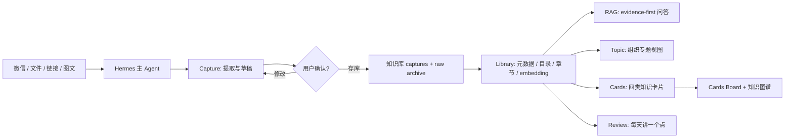

# Hermes Knowledge：AI-native 个人知识工作台

更新日期：2026-06-02（口径更新：2026-11）

## 一句话项目定位

Hermes Knowledge 是一个面向个人深度学习和知识复用的 AI-native PKM 原型。它把微信、文件、网页和图文材料接入 Hermes 主 Agent，经由 Capture、Library、RAG、Topic、Cards、Review 等能力模块，把零散材料加工成可阅读、可检索、可回顾、可再组合的知识资产。产品主界面是 Web-native 三栏工作台，配自研卡片板和知识图谱；Obsidian 仅作为可选的 Markdown 导出/外部编辑兼容。

这不是一个“AI 帮我总结文章”的小工具，而是一个围绕个人知识生命周期设计的 Agent 工作台：

- 材料先进入草稿，不直接污染知识库。
- 用户确认后入库；Markdown 导出保留可迁移性。
- Library 负责维护数据卫生和索引。
- RAG 负责 evidence-first 检索，并给出可追溯来源。
- Topic/Cards 负责组织专题、发现关系和沉淀知识卡片。
- Cards Board / Graph 负责让卡片和关系可浏览。
- Review 负责把知识重新带回用户视野。

## 背景痛点

个人知识库最大的问题通常不是“没有收藏”，而是收藏后失去流动性：

- 微信公众号、小红书、PDF、Markdown、图片等材料入口分散。
- 收藏后只有原文，没有适合自己复用的整理稿。
- 知识库文件越来越多，但资料、卡片、专题之间的关系不稳定。
- RAG 能回答，但经常不知道引用了什么、有没有真的用到材料。
- 洞察、概念、方法、边界等知识对象混在文章里，难以被再次调用。

这个项目的核心假设是：个人知识库不应该只靠“存”和“搜”，而应该有一条可控的 AI 加工流水线，让材料逐步从原始输入变成可复用知识。

## 用户与场景

目标用户是高强度学习和研究型个人，尤其是需要持续消化 AI 产品、Agent 工程、商业分析、职业发展等材料的人。

典型场景：

1. 在微信里看到一篇文章，直接转给 Hermes。
2. Hermes 提取内容并生成草稿预览。
3. 用户要求“全文保存”“总结核心内容”“方法论部分详细一些”等不同整理粒度。
4. 用户确认后入库到知识库。
5. Library 自动补齐 properties、目录纲要、章节切分和 embedding。
6. 后续用户问问题时，RAG 先找证据，再沿专题、卡片和资料网络扩展，给卡片按来源与引用加权。
7. 对跨材料形成的洞察、概念、方法和边界，Cards 生成四类知识卡片。
8. Cards Board 和知识图谱把卡片、资料和专题关系展示出来，辅助用户看见知识之间的关系。

## 产品能力闭环

这个闭环体现了一个重要产品取舍：AI 可以负责处理和建议，但关键资产入库前仍需要用户确认。这样既能提高效率，又避免自动化把错误内容写进长期知识库。

## Agent / 工具分工

| 模块 | 用户价值 | 关键职责 |
| --- | --- | --- |
| Hermes 主 Agent | 统一入口 | 理解用户意图、选择工具、组织微信/飞书回复 |
| Capture | 把材料变成可审阅草稿 | 提取内容、识别整理粒度、生成草稿、支持多轮修改、确认后入库 |
| Library | 保持知识库可信 | 对齐 DB 与文件、补 properties、目录纲要、章节切分、embedding、修复重复/断链 |
| RAG | 基于知识库回答问题 | 从 capture/section 证据出发，按来源与引用给卡片加权，沿专题/图谱扩展，输出引用 |
| Topic | 组织长期问题 | 聚合资料、卡片和开放问题，形成专题视图 |
| Cards | 沉淀可复用知识对象 | 生成洞察/金句、新知/概念、方法/框架、避坑/边界四类卡片，并做重复防护 |
| Review | 防止知识沉没 | 每天讲一个点，支持追问，记录被看过次数 |
| Cards Board / Graph | 让关系可见 | 用自研卡片板浏览已确认卡片，用知识图谱展示卡片—资料—专题关系 |

## 关键产品决策

### 1. 不做全自动入库

原始材料可能提取失败、总结跑偏、用户临时改变目标。如果直接入库，知识库会变成垃圾桶。因此 Capture 采用草稿确认模式：先生成可审阅预览，用户满意后再写入知识库。

### 2. raw 是归档区，不是日常阅读区

raw 保存原文证据，captures 保存整理后的日常阅读笔记。这样既保留可追溯性，又避免日常阅读视图被原文和 OCR 材料污染。

### 3. Library 是知识库管家，不是总结器

Capture 负责内容整理，Library 负责结构健康：文件是否存在、DB 是否一致、properties 是否完整、长文有没有目录和章节、embedding 是否可用。这个分工避免一个 Agent 同时负责“写文章”和“修数据库”。

### 4. Cards 不等于观点库

不是所有材料都必须提炼成观点。Knowledge Card 固定分为洞察/金句、新知/概念、方法/框架、避坑/边界四类。标准不是“有没有独特观点”，而是“能不能独立复用”。

### 5. RAG 不暴露多模式

用户不需要选择“快速搜 / 深搜 / 图检索”。RAG 对外就是问答工具；内部采用 evidence-first，先从 capture/section 找证据，再按来源与引用给卡片加权，沿专题和资料网络做适度扩展，并在时间预算内用已找到材料回答。

### 6. 为什么自研卡片板，而不是把 Obsidian Canvas 当主界面

早期版本确实用过 Obsidian Canvas 和 MOC 主题页。但卡片后来变成可检索、可加权的一等对象，Canvas 文件无法承担筛选、权限和检索状态。因此当前主线是 Web 自研卡片板 + 知识图谱；Obsidian Canvas 只保留为可选导出/历史兼容，不再作为产品依赖。

## 当前 v0.1 能力状态

已经基本跑通：

- Capture 支持公众号、小红书、文本、文件、图片/OCR 等入口的材料整理。
- 支持草稿预览、展开草稿、修改草稿、确认入库。
- 入库后写入知识库 `captures/`，原文进入 raw evidence 区。
- Library 可补齐属性、目录、章节和 embedding，并能做数据健康检查。
- RAG 可基于知识库回答，先找证据再给卡片加权，并展示可读来源。
- Topic/Cards 可组织专题、生成四类知识卡片。
- Cards Board 可按类别和专题浏览卡片，知识图谱可展示卡片—资料—专题关系。
- Review 已从“考试”调整为“每天讲一个知识点”的回顾助手。
- 长输出支持按需文件化，避免微信字数限制。

仍是 v0.1，不是成熟商业产品：

- Capture 对极长、复杂、多模态材料的鲁棒性还需要继续积累样本。
- RAG 的答案质量需要持续用真实问题校准，不只是看能否命中材料。
- Run Ledger 已有基础，但用户可读的运行观测界面还不完整。
- 安装、配置、权限、错误恢复还偏个人环境，不适合直接给其他用户使用。

## 可展示亮点

### 亮点一：从 Prompt 到工作流

项目没有试图用一个超级 Prompt 解决所有问题，而是把知识管理拆成多个可控环节。LLM 负责理解、整理、解释和结构判断；代码负责数据一致性、状态流转、文件写入、引用追踪和安全边界。

### 亮点二：Web-native 工作台就是产品界面

主界面是三栏 Web 工作台：左侧资料定位，中间阅读/审阅，右侧来源与 AI 辅助。Markdown 导出保留可迁移性，Obsidian 只是可选的外部编辑兼容，不再是产品主界面。

### 亮点三：用户确认机制

所有重要资产都先进入草稿，用户可以修改、展开、确认，再入库。这是个人知识场景里很关键的信任设计。

### 亮点四：可追溯 RAG

RAG 不只返回答案，还要显示材料名、章节名和引用来源。长回答可以输出文件，避免微信消息长度限制破坏阅读体验。

### 亮点五：四类知识卡片和关系可视化

Knowledge Card 把跨材料的洞察/金句、新知/概念、方法/框架、避坑/边界沉淀成可复用对象；Cards Board 负责筛选和详情，知识图谱展示卡片、资料、专题之间的来源与关系，让知识库从“文件列表”变成“关系网络”。

## 面试可讲的产品方法

### 需求发现

这个项目不是从“我要做一个 Agent”开始，而是从真实使用中的摩擦开始：材料很多、入口很多、知识库脏、总结不稳定、引用不可信、旧知识容易沉没。

### 产品抽象

把个人知识管理拆成六类对象：

- 原始材料：raw archive
- 整理笔记：capture
- 专题：topic / theme view
- 知识卡片：knowledge card（内部仍沿用 `garden_cards` 表）
- 检索证据：section / identity embedding
- 复习对象：review item

每类对象对应不同的用户价值和 Agent 职责。

### 交互设计

微信适合短回复，所以默认只返回审阅预览；用户要看全文或完整引用报告时再发文件。这个设计同时考虑了微信限制和用户决策成本。

### 评测思路

评测不是只看“模型有没有回答”，而是按链路拆：

- Capture 是否按用户要求保留粒度和重点。
- Library 是否保证 DB、raw、capture、embedding 一致。
- RAG 是否先找到足够证据，是否只列实际引用。
- Cards 是否生成有复用价值的四类卡片，是否避免重复。
- Review 是否能围绕当前材料继续追问。
- Cards Board / Graph 是否帮助看见关系，而不是制造视觉噪音。

## 面试追问准备

### Q1：这和普通 RAG 有什么区别？

普通 RAG 重点是“问一个问题，搜材料回答”。Hermes Knowledge 更关注知识生命周期：材料进入、草稿确认、结构维护、图谱扩展、知识卡片、回顾和可视化。RAG 是其中一环，不是全部产品。

### Q2：为什么自研 Web 工作台，而不是做 Notion/Obsidian 插件？

因为目标不是单点总结，而是把草稿、检索、卡片和专题关系放进同一个产品状态。插件很难承载三栏工作台、卡片加权检索和图谱浏览；自研 Web 工作台可以把这些对象串成可控流水线。Obsidian 只作为 Markdown 兼容层。

### Q3：为什么不全自动生成 Knowledge Card？

Knowledge Card 是高价值知识对象，不是所有文章都值得生成卡片。自动乱生成会让知识库变成摘要库。因此系统先发现候选关联，再生成草稿，最后由用户确认。

### Q4：怎么处理 AI 总结跑偏？

设计上有三层防护：草稿确认、多轮修改、入库后 Library 结构维护。对 RAG 回答则通过引用和来源标题让用户能追溯依据。

### Q5：项目最大的技术/产品难点是什么？

不是接一个模型 API，而是处理不稳定的真实输入和状态边界：微信字数限制、长文截断、小红书多图文、文件输入、知识库文件同步、SQLite 数据一致性、RAG 引用可追溯、旧会话污染等。

### Q6：下一步怎么做成真正产品？

优先不是继续加 Agent，而是补产品化体验：

- 用户可读的运行观测面板。
- 知识库健康中心。
- 更系统的 RAG/Capture 质量评测集。
- 安装配置和错误恢复流程。
- 面向多用户的权限和数据隔离。

## 简历写法

可以压缩成这样：

> 设计并实现 Hermes Knowledge，一个基于 Hermes Agent Framework + SQLite + 自研 Web 前端的 AI-native 个人知识工作台。系统支持从微信、网页、文件和图文材料中提取内容，生成可审阅草稿并确认入库；通过 Library Agent 维护元数据、章节和 embedding；通过 evidence-first RAG、资料 → 卡片 → 专题的知识结构、自研卡片板和知识图谱实现可追溯问答、卡片沉淀、专题组织和知识关系浏览。项目重点解决了长文处理、用户确认、引用可信、数据一致性和微信输出限制等真实产品问题。

## 当前边界

这份材料适合用于 AIPM 面试和作品集展示，但有几个口径要保持稳妥：

- 不说“已经是成熟商业产品”，说“个人可用的 v0.1 产品原型”。
- 不说“完全自动知识库”，说“用户确认 + Agent 辅助加工”。
- 不说“所有多模态都稳定支持”，说“已经支持并针对小红书/图片/OCR 做过链路优化，仍需更多真实样本验证”。
- 不说“RAG 完美回答”，说“已支持 evidence-first 检索、图谱扩展和可追溯引用；已完成一次 20 条 query 的 DashScope 语义检索重跑（Recall@5 0.389→0.833），答案质量仍需持续评测”。

