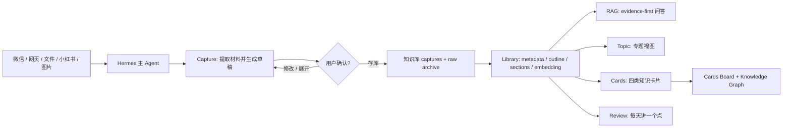

# Hermes Knowledge 面试材料与产品说明

更新日期：2026-06-04（口径更新：2026-11）

## 1. 项目定位

Hermes Knowledge 是一个面向个人深度学习和知识复用的 AI-native 知识工作台。它把微信、网页、文件、小红书图文、图片/OCR 等材料接入 Hermes 主 Agent，通过 Capture、Library、RAG、Topic、Cards、Review 等能力模块，把零散材料加工成可阅读、可检索、可追溯、可回顾、可再组合的知识资产。主界面是 Web-native 三栏工作台，配自研卡片板和知识图谱；Obsidian 仅作为可选的 Markdown 导出/外部编辑兼容。

一句话讲清楚：

> 它不是一个“AI 总结文章”的工具，而是一条围绕个人知识生命周期设计的 Agent 工作流：材料进入、草稿确认、结构维护、可追溯问答、知识卡片沉淀、专题组织和每日回顾。

## 2. 用户与痛点

目标用户是高强度学习、研究和内容消化型个人，比如 AI 产品经理、研究型创作者、投资/咨询/产品从业者。

真实痛点不是“没有收藏”，而是收藏后失去流动性：

- 入口分散：微信、网页、PDF、Markdown、小红书图文、图片材料各走各的。
- 材料太长：原文很难复用，简单摘要又容易漏掉关键论证。
- 知识库变脏：文件名不可读，raw/capture 混在一起，DB 与文件容易断链。
- RAG 不可信：回答看似合理，但不知道到底用了哪些材料。
- 知识难沉淀：洞察、概念、方法和边界散落在文章里，无法被再次调用。
- 旧知识沉没：存进去以后很少再被主动带回视野。

## 3. 产品闭环

核心产品原则：

- AI 可以建议和加工，但长期资产入库前必须给用户确认。
- raw 是证据归档，capture 是日常阅读笔记。
- RAG 回答必须可追溯，先找证据，再给卡片加权，不能只给“像真的”答案。
- Knowledge Card 不强迫所有内容变成观点；卡片固定四类：洞察/金句、新知/概念、方法/框架、避坑/边界。
- Web 工作台是主载体；Markdown 导出保留可迁移性，Obsidian 是可选的兼容层，不是存储真相。

## 4. Agent / 工具分工

| 模块 | 用户价值 | 关键职责 |
| --- | --- | --- |
| Hermes 主 Agent | 一个统一入口 | 理解微信/飞书消息，选择工具，组织回复 |
| Capture | 把材料变成可审阅草稿 | 提取内容，理解用户整理粒度，生成草稿，支持修改和确认入库 |
| Library | 保持知识库可信 | 对齐 DB 与文件，补 properties、目录、章节、embedding，修复重复/断链 |
| RAG | 基于知识库回答 | 从 capture/section 证据出发，按来源数与引用数给卡片加权，沿专题与图谱扩展，输出引用 |
| Topic | 组织长期问题 | 聚合资料、卡片和开放问题，形成专题视图 |
| Cards | 沉淀可复用知识对象 | 生成四类知识卡片（洞察/金句、新知/概念、方法/框架、避坑/边界），并做重复防护 |
| Review | 防止知识沉没 | 每天讲一个知识点，支持追问，记录被看过次数 |
| Cards Board / Graph | 让关系可见 | 用自研卡片板浏览已确认卡片，用知识图谱展示卡片—资料—专题关系 |

## 5. 关键产品决策

### 5.1 不做全自动入库

原因：个人知识库是长期资产。AI 自动写错一次，后面的 RAG、Review、Cards 都可能被污染。

设计：Capture 先生成草稿预览，用户可以展开、修改、确认。只有用户回复“存库”后，才写入知识库。

面试表达：

> 我没有把自动化当成唯一目标，而是把“长期知识资产可信”放在第一位。AI 能提高处理效率，但入库这种高风险动作应该保留用户确认。

### 5.2 raw 和 capture 分层

raw 保存原文证据，capture 保存整理后的日常阅读笔记。这样既能追溯来源，又不让网页噪音、OCR 文本和长原文污染日常阅读视图。

### 5.3 Library 是知识库管家

Library 不负责写观点，也不负责回答问题。它负责结构健康：文件是否存在，DB 是否一致，properties 是否完整，长文有没有目录和章节，embedding 是否可用。

这个分工避免一个 Agent 同时负责“创作内容”和“修数据”，边界更清楚。

### 5.4 RAG 对用户保持简单

用户只问问题，不需要选择“快速搜 / 深搜 / 图检索”。复杂性留在内部：先从资料/章节找证据，再沿专题、卡片和资料关系扩展；卡片按来源数与引用数加权，不无条件置顶；最后只引用实际用到的材料。

### 5.5 Cards 不等于观点库

不是所有材料都一定有观点。Knowledge Card 的标准是“能否独立复用”，所以它固定分为四类：洞察/金句、新知/概念、方法/框架、避坑/边界。

### 5.6 为什么自研卡片板，而不是把 Obsidian Canvas 当主界面

早期版本确实用过 Obsidian Canvas 和 MOC 主题页，但卡片后来变成可检索、可加权的一等对象，Canvas 文件无法承担筛选、权限和检索状态。因此当前主线是 Web 自研卡片板 + 知识图谱；Obsidian Canvas 只保留为可选导出/历史兼容，不再作为产品依赖。

## 6. 当前能力状态

已经基本跑通：

- Capture 支持微信、公众号、小红书、文本、文件、图片/OCR 等入口。
- 支持草稿预览、展开草稿、修改草稿、确认入库。
- 入库后写入知识库 `captures/`，原文进入 raw evidence 区。
- Library 可以补 properties、目录纲要、章节切分、identity/section embedding，并做数据健康检查。
- RAG 可以基于知识库回答，先找证据再给卡片加权，并展示可读来源。
- Topic/Cards 可以组织专题、生成四类知识卡片。
- Knowledge Card 已有重复防护。
- Cards Board 可浏览已确认卡片，知识图谱可查看卡片—资料—专题关系。
- Review 已从“考我”调整成“每天讲一个点”的知识回顾助手。
- 长输出支持按需文件化，避免微信字数限制。
- Knowledge 与 Life Assistant 已拆成两个独立 capability projects，共用一个 Hermes runtime。

仍是 v0.1：

- 极长文、多图文、多模态材料还需要更多真实样本继续验证。
- RAG 已支持 evidence-first 检索和引用；已完成一次 20 条 query 的 DashScope 重跑（Recall@5 0.389→0.833），答案质量仍需持续评测。
- Run Ledger 和日志已有基础，但还需要更用户可读的运行观测界面。
- 面向其他用户时，还需要安装配置、权限隔离、错误恢复和多环境部署能力。

## 7. 面试讲述结构

### 7.1 30 秒版本

我做了一个 AI-native 个人知识工作台，叫 Hermes Knowledge。它把微信里的公众号、小红书、文件或图片接进 Web 工作台：Hermes 先生成可审阅草稿，我确认后再入库。入库后 Library 会补目录、属性、章节和 embedding；之后我可以基于知识库问问题，RAG 会先找证据、再按来源和引用给卡片加权，回答带引用；多篇材料形成关系时，Cards 会沉淀成知识卡片，再用自研卡片板和知识图谱展示关系。它的重点不是单篇总结，而是把材料进入、确认、维护、检索、卡片和回顾串成完整闭环。

### 7.2 3 分钟版本

这个项目来自一个很具体的问题：我平时会收集大量 AI 产品、Agent 工程、商业分析和职业发展材料，但普通收藏最后会变成文件堆，难以复用。

所以我做了 Hermes Knowledge。它把微信作为低摩擦入口，把 Web 工作台作为主载体，中间用一组 Agent 工具完成知识加工；Markdown 导出保留可迁移性，Obsidian 只是可选的外部编辑兼容。

第一步是 Capture。用户发链接、文件或图片后，系统先生成草稿，而不是直接入库。用户可以要求“全文保存”“总结核心内容”“方法论部分详细一些”，也可以继续修改，满意后再存库。

第二步是 Library。入库后它负责补元数据、目录、章节和 embedding，并检查 DB 与知识库文件是否一致。这样知识库不是一堆 Markdown 文件，而是可维护的数据系统。

第三步是 RAG、Topic、Cards。RAG 负责基于知识库回答，采用 evidence-first 检索并显示引用来源；Topic 组织专题视图；Cards 把跨材料的洞察、概念、方法和边界沉淀成四类可复用知识卡片。

最后是 Review、Cards Board 和知识图谱。Review 每天带回一个知识点，卡片板与图谱展示卡片、资料和专题的关系。

这个项目最重要的产品取舍是：我没有追求全自动，而是追求“可控的 AI 工作流”。模型负责理解、整理和判断；确定性代码负责状态流转、文件写入、引用约束和数据一致性。

## 8. Demo 脚本

### Step 1：材料进入

用户在微信发：

> 这篇文章写得不错，总结核心内容，方法论部分详细一些：链接

展示点：

- 入口在微信，不需要打开后台。
- 支持自然语言指定整理粒度。
- Capture 不直接入库，而是生成草稿预览。

### Step 2：草稿审阅

展示 Hermes 返回：

- 标题
- 重点回应
- 简短总结
- 下一步操作：展开草稿 / 修改 / 存库

讲法：

> 微信有字数限制，所以默认返回审阅预览。用户需要全文时再展开或发文件，而不是把长文硬塞进一条消息。

### Step 3：确认入库

用户回复：

> 存库

展示知识库：

- `captures/` 中的整理笔记
- raw evidence 区中的原文归档
- 可读文件名、properties、目录纲要、章节

### Step 4：基于知识库问答

用户问：

> 基于我的知识库，AI Agent 工程化到底应该怎么理解？

展示点：

- 回答里有来源标题。
- 参考来源只列实际使用的材料。
- 长答案可以发文件。

### Step 5：生成知识卡片，进入卡片板

用户说：

> 扫描最近保存的内容，看看有没有可以整理成知识卡片的关联。

展示点：

- 先给候选关联，不直接乱生成。
- 用户选择后生成 Knowledge Card 草稿。
- 确认后进入 Cards Board。
- 卡片板展示四类卡片及其来源，知识图谱展示卡片—资料—专题关系，而不是普通文章列表。

## 9. 面试追问准备

### Q1：这和普通 RAG 有什么区别？

普通 RAG 主要解决“问问题，搜材料，生成答案”。Hermes Knowledge 更关注知识生命周期：材料进入、草稿确认、结构维护、图谱扩展、知识卡片、每日回顾和关系可视化。RAG 是其中一环，不是全部产品。

### Q2：为什么自研 Web 工作台，而不是做 Notion/Obsidian 插件？

因为我的目标不是单点总结，而是把草稿、检索、卡片和专题关系放进同一个产品状态。插件很难承载三栏工作台、卡片加权检索和图谱浏览；自研 Web 工作台可以把这些对象串成可控工作流。Obsidian 只作为 Markdown 兼容层，不是主界面。

### Q3：为什么不全自动生成 Knowledge Card？

Knowledge Card 是高价值知识对象，不是所有文章都值得生成卡片。自动乱生成会让知识库变成摘要库。所以系统先发现候选关联，再生成草稿，最后由用户确认。

### Q4：如果 AI 总结跑偏怎么办？

设计上有几层防护：第一，所有 Capture 都先生成草稿；第二，用户可以展开和修改；第三，入库后 Library 只做结构维护，不改写观点；第四，RAG 回答必须显示来源，用户可以追溯依据。

### Q5：长文章怎么处理？

Capture 不应该简单截断，也不应该把长文强行压成几句话。更合理的方式是先按用户要求决定整理粒度：全文保存、常规整理、重点部分展开。入库后 Library 会补章节和 section embedding，后续 RAG 可以定位到具体章节，而不是一次读完整篇。

### Q6：怎么处理微信输出限制？

默认短回复只给审阅预览、状态和下一步操作。长草稿、长 RAG 答案和完整引用报告按需输出文件。这样既不被微信截断，也不让用户每次都收到很长的信息。

### Q7：怎么避免 RAG 引用错列？

原则是“候选材料不等于引用材料”。正文实际用了哪些 evidence，尾注就只列哪些来源。之前项目里专门修过“搜索候选误出现在参考来源”的问题。

### Q8：怎么判断 Knowledge Card 是否重复？

不能只看标题，要看核心主张、来源材料和语义相似度。命中近似卡时，系统应该提示已有卡片，而不是再生成一张。

### Q9：项目里 LLM 和硬编码怎么分工？

LLM 适合做理解、整理、解释、模糊判断和候选关系发现。确定性代码适合做状态流转、数据写入、文件路径、DB 一致性、引用约束、去重规则和安全边界。这个项目里我一直避免把无限场景写成硬编码分支，而是尽量通过工具契约和对象边界让 Agent 自己判断。

### Q10：下一步如何产品化？

优先不是继续堆 Agent，而是补产品化底座：

- 运行观测面板：用户能看到每次工具调用、状态流转和失败原因。
- 知识库健康中心：DB、文件、embedding、raw/capture 一致性一眼可见。
- Capture/RAG 评测集：用真实材料和真实问题衡量质量。
- 安装配置和错误恢复：从个人项目变成别人能部署的产品。
- 权限与数据隔离：为多用户或多项目做准备。

## 10. 面试材料证据清单

建议准备这些截图或文件：

- 微信里 Capture 草稿预览截图。
- “展开草稿”和“存库”的多轮交互截图。
- Web 三栏工作台截图（资料定位 / 阅读与审阅 / 来源与 AI 辅助）。
- 知识库 `captures/` 中一篇整理后的笔记。
- raw evidence 区中的原文归档，说明证据保留。
- Library 补目录/章节后的长文。
- RAG 回答截图，突出来源标题和引用。
- 卡片板中的 Knowledge Card 详情。
- 知识图谱截图（卡片—资料—专题关系）。
- `docs/hermes-knowledge-v0.1-acceptance.md` 的功能验收摘要。
- `docs/hermes-project-map.md` 的三仓库职责边界。

## 11. 可以承认的不足

这些不足要主动讲，但不要讲成失败：

- 目前是个人可用 v0.1，不是成熟 SaaS。
- 多模态、小红书、长 PDF 等输入还需要更多真实样本压测。
- RAG 质量需要持续评测，不能只凭几次 demo 判断。
- 运行日志和 Run Ledger 还需要更友好的可视化。
- 当前部署偏本地个人环境，还没有多用户权限、团队协作和完整安装体验。

## 12. 最适合 AIPM 面试的表达重点

这项目最适合展示的不是“我会写代码”，而是：

- 我能从真实痛点定义 AI 产品问题。
- 我能把模糊需求拆成对象、流程、状态和边界。
- 我知道 AI 不可靠，所以设计了确认、引用、修复和观测机制。
- 我能把模型能力放进可用工作流，而不是只做一个聊天 demo。
- 我能在真实使用中持续迭代：长文、小红书、文件输入、引用、重复卡片、卡片板与图谱可读性、仓库边界都来自实际测试反馈。

